# How operations work

How Renuterra Field Ops runs collections end to end: what is set up once, what happens every day, and what happens when a customer asks for a service. It describes the prototype as built, and marks what is **planned** (driver mobile app, closing and billing).

Business rules come from [specs/route-definition.md](./specs/route-definition.md). Names follow [glossary.md](./glossary.md).

---

## 1. The big picture

Everything hangs off the **Route**. A Route is a standing template, for example `RWC-DXB-REL-001` "Dubai REL Morning A": what it collects, where, with which truck and driver, on which days and shift. Each day the system generates a **Route instance** from it, and that instance is what dispatch confirms and the driver works.

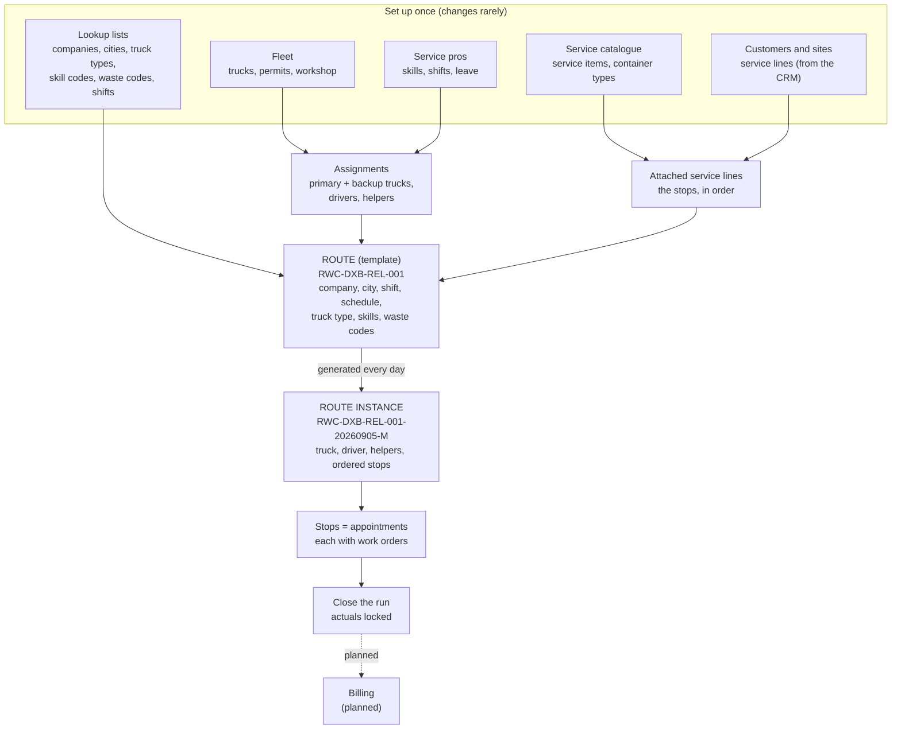

| Object | Lives for | Who owns it | Screen |
| --- | --- | --- | --- |
| Route (template) | Months, versioned | Operations manager | Routes |
| Assignment | Weeks or months (leave, fleet moves) | Operations manager | Route → Resources |
| Service line | Contract lifetime | CRM (sales) | Customer → Service points |
| Route instance | One day and shift | Dispatcher, driver | Dispatch |
| Appointment (stop) | One visit | Dispatcher, driver | Appointments, appointment detail |
| Work order | One task on a visit | Driver | Appointment detail (later: driver app) |

---

## 2. Setting up a route

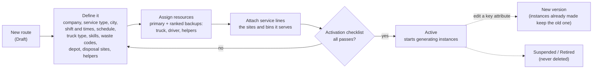

Checks the system makes along the way:

| When | Check | Result if it fails |
| --- | --- | --- |
| Assigning a truck | Right truck type, same company or shared pool, city permit, registration and insurance in date | Blocked; expiring within 30 days only warns |
| Assigning a driver or helper | Every required skill in date (licence, operation, city, night clearance), not primary on another route in the same shift | Blocked; expiring within 30 days only warns |
| Attaching a service line | Same city, waste code accepted, right service type, frequency fits the schedule | Blocked |
| Attaching a service line | Already on another route | Allowed, as a transfer |
| Attaching a service line | Capacity above 90% / above 100% | Warning / blocked unless the owner overrides |
| Activating | All required fields filled, a primary truck and driver, times inside the shift, no forbidden stream mix | Blocked |

---

## 3. The daily cycle

In production this runs at **20:00 the day before**. In the prototype the dispatcher presses **Generate** on Dispatch for tomorrow, or up to 7 days ahead.

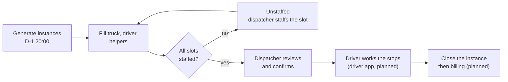

### 3.1 What Generate does, step by step

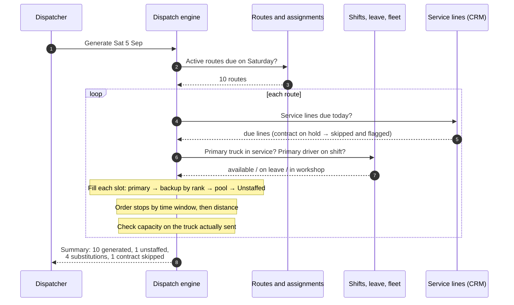

### 3.2 How each slot is filled

The same order applies to the truck, the driver and every helper slot.

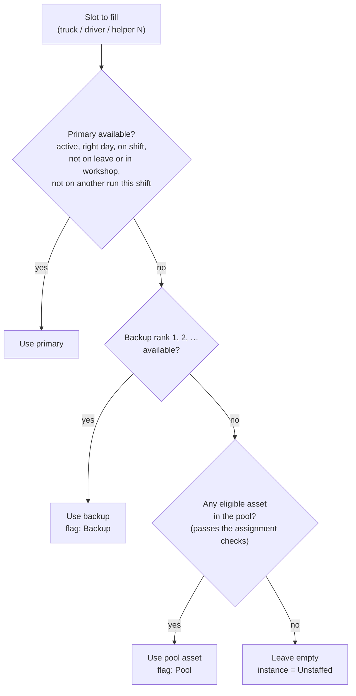

Every assigned truck and person is **re-checked each time a day is generated** (R5, nightly re-check): an expired licence, skill certificate or permit skips them to the next candidate, and the instance carries an **Assigned … skipped** flag naming the failed check. Runs that already exist are re-checked live on the board, so a licence that expires after generation still blocks a plain Confirm.

### 3.3 Route instance status

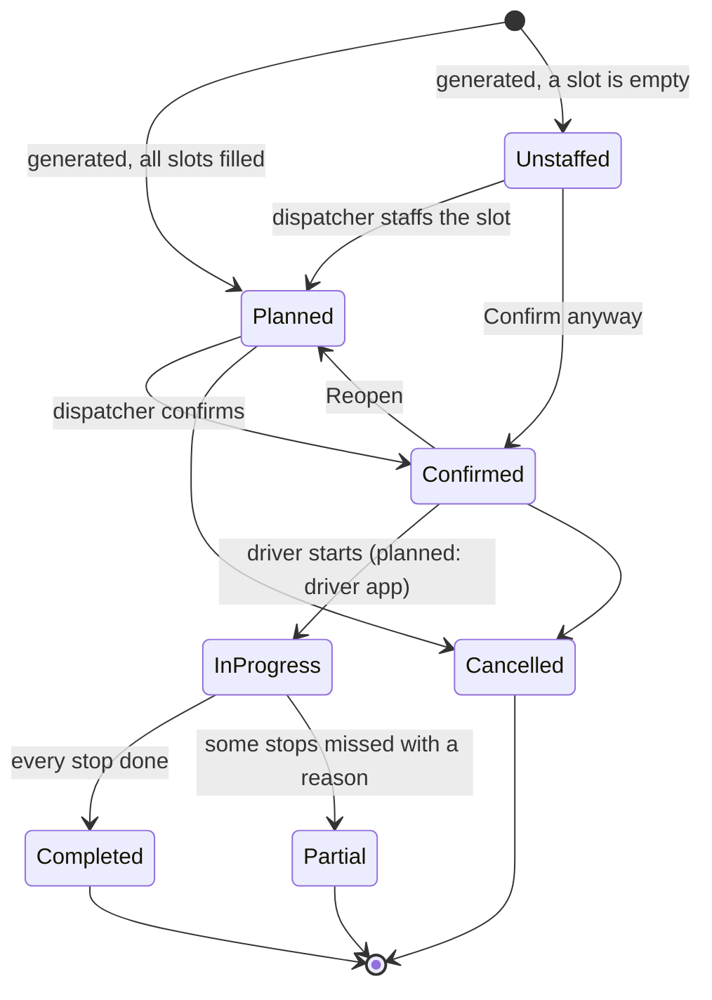

> In the prototype, an instance follows its stops once work starts: the dispatcher acts the stops out on the appointment page and the instance moves to In progress, then Completed or Partial by itself. History (31 Aug to 4 Sep) shows finished runs. **Closing** is a separate step on top of the status (see 3.7).

### 3.4 Route score and Optimize

Every Route and every instance carries a **score** (0–100, Excellent / Good / Fair / Poor) so a poor route design or a badly shaped day stands out before anyone drives it.

| Metric | What it measures | Best → worst |
| --- | --- | --- |
| Neighbourhood | Average km from each stop to its nearest other stop | ≤ 1 km → ≥ 6 km |
| Tightness | Average km of the stops from the route's centre | ≤ 2 km → ≥ 12 km |
| Drive share | Driving incl. tipping trips ÷ the whole run | ≤ 45% → ≥ 85% |
| Capacity use | Planned work ÷ route capacity, in m³ / visits / kg | 70–90% full marks; 0% or ≥ 120% none |
| Window fit | Share of stops planned inside their time window | 100% → 0% |
| Trip efficiency | Trips of work vs trips planned (a half-empty second trip costs) | |
| Penalties | Over capacity, stops outside window, unstaffed slots, substitutes | points off |

**Optimize** (per instance, or all unconfirmed instances of a day) re-sequences the open stops by time window then nearest next stop, recomputes planned times and tipping trips, and shows the score before → after with Undo. Confirmed instances are left alone. Phase 2, with real GPS cycle times, slots into the same place.

### 3.5 What the dispatcher sees and does (Dispatch board)

| They see | They can |
| --- | --- |
| One card and one timeline row per instance: status, **score**, route code, shift, driver, helpers, truck | Confirm one, **Confirm ready** (all ready ones), Reopen, **Optimize** |
| Flags: **Backup driver**, **Pool helper**, **Unstaffed: driver**, **Assigned driver skipped** (failed a check at generation), **Over capacity 112% (payload)**, **Stops outside window**, **Contract skipped**; plus a live eligibility line for anyone on the run whose licence or permit fails today (R5) | **Staff…** an empty slot (only eligible people or trucks are offered) |
| Capacity bars: stops and load against the truck | Change truck or driver, send open stops to the backlog |
| The map: pins in stop order, coloured by route; depots and disposal sites as square badges, with a dashed leg from each tipping trip to its facility; selecting a route highlights its own depot and sites | Drag a stop to another route, or **Move to route**; hide sites with **Sites** |
| **Backlog**: ad-hoc jobs not on any instance yet | **Add to its instance** (default route), **Assign to route**, **Place backlog** |

### 3.6 Capacity: limits, forecast and actuals

Business rules: [spec section 8](./specs/route-definition.md#8-route-capacity). The spec states the goals; the structure below is how the prototype meets them.

**Capacity belongs to the truck, not the service type.** A truck has two physical limits, and the planned load is checked against both. Whichever is closer to full is the **binding limit**, and it decides the run's utilisation, the R11 warning and block, and the R16 **Over capacity** flag. The service type only supplies the default headline unit while a Route is being drafted, before it has a truck type. That's why the spec's mixed rows (REL "capped by payload", skip "also capped by payload per lift", medical "payload and container slots") don't need special cases.

| Truck types | Headline limit | Second limit | How the second one is checked |
| --- | --- | --- | --- |
| REL-07 / 14 / 25 | Volume: body m³ × compression 1:5, × trips | Payload kg × trips | Shift total |
| Vacuum tanker | Volume: tank m³ (no compression), × trips | Payload kg × trips | Shift total |
| Skip loader, hook loader | Visits per shift (cycle time) | Payload kg | **Per container**: one skip or RoRo at a time, so only the heaviest one is checked, and it only counts once it's over |
| Medical, ADR box truck | Payload kg × trips | Secured container slots × trips | Shift total |
| Flatbed | Payload kg × trips | none | |

**What one stop puts on the truck** (`lineLoad` in `src/features/field-service/route-rules.ts`):

| Handling | Volume | Weight | Slots | Visits |
| --- | --- | --- | --- | --- |
| Empty on site (bins) | litres × qty × fill rate | qty × kg per unit | 0 | 1 |
| Pump-out | litres | qty × kg per litre | 0 | 1 |
| Exchange (skip, RoRo, compactor tip & return) | 0 (the container rides, not its contents) | qty × kg per unit | 0 | qty |
| Packaged (sharps boxes, drums) | 0 | qty × kg per unit | qty, except bags (they ride in the truck's own carts) | 1 |

Example, Route RWC-DXB-REL-001 on its busiest day: volume 29.6 of 250 m³, payload 3,900 of 24,000 kg, so volume binds at 16%. If tonight's REL-25 is swapped for a REL-14 backup, both limits shrink and the engine recalculates them (spec section 8.5 rule 3).

#### Resolving Over capacity (R16, spec section 8.5 rule 3)

The board judges capacity on the **live** load of every run that can still change, not on the flag set at generation (that goes stale once stops or the truck change). When the forecast passes 100% of the binding limit, the card shows an **Over capacity** box with the two fixes the spec allows, and Confirm is blocked until one is chosen or overridden:

- **Move N stops to …:** open stops are taken off the end of the run until it fits, and the suggestion names the same-type, same-city run with the most room after the move, with both forecasts before and after ("This run 112% → 96% · REL-005 40% → 58%"). One click moves them all.
- **Accept N extra trips (+N tips):** the smallest number of extra trips (cycles, on skip and hook routes) that brings the run to 100% or under, up to 3. It is recorded on the instance with who accepted it and when (`RouteInstance.extraTrips`), and the capacity bar counts it from then on.

#### Forecast: the fill rate learns, the dispatcher decides

The spec sets a standard fill rate of 80%, a per-line override, and a **suggested** rate from history that the dispatcher accepts or ignores (spec section 8.2). It is never applied silently, because a promotion week or Ramadan hours can make history misleading. The resolution order for each service line:

1. **Manual override** on the line, if set.
2. Otherwise the Route's standard (80%).
3. Next to it, the **suggested rate**: a recency-weighted average of the line's last 12 visits (each older visit counts 15% less), rounded to 5% like drivers report it. It appears once a line has 4 visits, the tooltip shows the visit count and range, and **Accept** sets it as the line's override (with Undo). Shown in the Consumes column of the Route's Service lines tab.

Where "actual fill" comes from:

- **Driver's fill level (used today):** `fillLevelPct` on each work order, and on each past visit in `visit-history.json` (every due visit in the 8 weeks before the live fixtures; the suggestion reads the last 12).
- **Weight (the spec's preferred source, planned):** actual kg ÷ (litres × the stream's typical density). This needs a density per waste stream in the waste-code master (e.g. food ~0.5 t/m³, general ~0.15 t/m³ loose), which doesn't exist yet. Once it does, the two sources cross-check each other: a large gap usually means contamination or compaction at the customer's site.

The same idea applies in each truck type's own unit: kg per bag, box or drum per customer (medical, hazardous), litres per pump-out against days since the last service (tanker), and cycle time per site and facility (skip, hook). The cycle time is what refines planned visits per shift, which the spec calls phase 2.

#### Actuals and the forecast snapshot

- **Snapshot at Confirm:** when an instance is confirmed, it stores its planned load per limit and the fill rate used for each stop. Without this, "forecast vs actual" can't be reconstructed later, because the override, the suggestion and the truck can all change after the run.
- **Actuals during the run:** completed work orders add up into actual load per limit (weights are estimates until the weighbridge ticket arrives, and are marked that way).
- **At closure (spec section 8.5 rule 4):** actual tonnes, lifts and trips are written back to the instance and rolled up to the Route. They feed the *Route utilisation, planned vs actual, by week* report (spec section 11, report 2).

**On the Dispatch board,** each run's capacity bar shows three layers in the binding unit:
- **worst case**: every container 100% full, in light grey;
- **forecast**: solid;
- **actual so far**: fills as stops complete.

The "Worst" note is shown only when it differs from the forecast (volume; weights and counts are the same in both). Below the bar, the truck's other limit is listed when the run is at least half full and that limit is within 10 points of the binding one. The bar turns amber at 90% forecast and red over 100%, and **Running heavy** appears when completed stops are 15% or more over their own forecast. After Confirm, the card also shows "Forecast at Confirm X%, now Y%" when the plan has moved 5 points or more.

#### Later: the forecasting assistant (LLM)

The forecast number itself comes from the statistics above, not from an LLM. The LLM's job, once the history exists, is to explain an unusual forecast, take context the numbers can't see into account (promotions, holidays, events, notes from the CRM), and propose moves ("shift the Marina Gate stops to REL-005, forecast 40%"). It reads the history built here: one record per visit (line, date, weekday, shift, containers, fill %, kg, weight source, contamination) and one per run (snapshot, actuals, binding limit, stops added or moved).

#### Open questions for operations

1. **COMP (compactor / bulk).** Spec section 8.1 treats COMP as a compacting truck (volume), but the approved truck list (section 7.2) has only the flatbed for it, which is weight-based. With capacity on the truck, both work, but a COMP route only gets a volume limit if a compactor truck type with a body size is added to section 7.2. Mobile compactor *exchanges* (tip and return) already run on hook routes.
2. **Stream densities** for the weight-to-fill conversion.
3. **Container slots:** confirm that one rigid container (sharps box, drum, cart) takes one slot and that bags take none.

| Capacity piece | Status |
| --- | --- |
| Limits per truck type, binding limit in R11, R16 and the flags | Built |
| Over capacity resolution on the board: split stops to the run with room, or accept extra trips | Built |
| Every limit on the Route's Capacity card; the close-behind limit on Dispatch | Built |
| Suggested fill rate from history, with Accept and Undo | Built (from drivers' fill levels) |
| Three-layer bar on Dispatch (worst case / forecast / actual), Running heavy | Built |
| Forecast snapshot at Confirm (`RouteInstance.forecastSnapshot`), drift note | Built |
| Planned vs actual by week per Route (Performance tab) and across routes (Reports, report 2), from visit history and finished runs | Built |
| Trips-per-shift suggestion from recent weeks, with Accept | Built |
| Route score's capacity metric on the binding limit (still the headline unit) | Planned |
| Stream densities, cycle-time learning | Planned (needs operations input) |

### 3.7 Closing a run (R17, R18)

Business rules: spec section 6.1 (closed by, closed at; closure locks actuals and releases them to billing and costing), R17 and R18.

**Close run…** appears in a run's menu once its day has come and work began, or once the day is over; the panel header counts runs **to close**. The closing sheet has:

1. **Stops to resolve:** every stop that isn't completed, failed or cancelled needs a decision before **Close run** is enabled (R17): **Missed** with a failed-visit reason (it becomes a failed visit, its open work orders not done) or **Reschedule to the next day** (back to the backlog, same arrival window).
2. **Weighbridge tickets** (optional in the prototype): one per facility the run tipped at, with net kg, and the variance against what the stops recorded.
3. **Odometer** out and in (optional), with the variance against the planned km.
4. A note for billing or the planner.

Closing saves an `InstanceClosure` on the run: who and when, tickets, odometer, the stops resolved, and the **actual load per truck limit** computed after the decisions (a stop marked missed may already have recorded part of its work). The run shows a **Closed** badge and a summary line, and becomes read-only: no moves, staffing changes, Optimize or Reopen. Corrections go in as dated **adjustments** (R18) from the menu, kept with the run.

What closing does not do yet: release actuals to billing. Weekly planned vs actual per Route is on its Performance tab and on Reports (report 2); it reads the visit history and finished runs.

### 3.8 Cancelling runs (spec section 6.2 rules 5 and 8)

**Cancel run…** in a run's menu applies to runs that haven't started and aren't closed (planned, unstaffed or confirmed). **Cancel the day**, in the panel's Auto-Plan menu, cancels every such run on the day at once, for a public holiday or a city-wide closure. Both ask for a reason (public holiday, vehicle breakdown, weather, customer sites closed, nothing to collect, other) and a note. The run is kept with its reason, never deleted (rule 8), and shows "Cancelled 13:00: public holiday" on its card; its open stops go back to the backlog for the dispatcher to place on another day.

Planned: a public-holiday calendar that labels holidays on the date strip and the Generate dialog, and the Route's "skip holidays" flag (rule 5).

---

## 4. One visit (a stop)

Each stop is an **appointment** with one or more **work orders** (one per service item). Today the dispatcher clicks through these on the appointment page; later the driver does them in the mobile app.

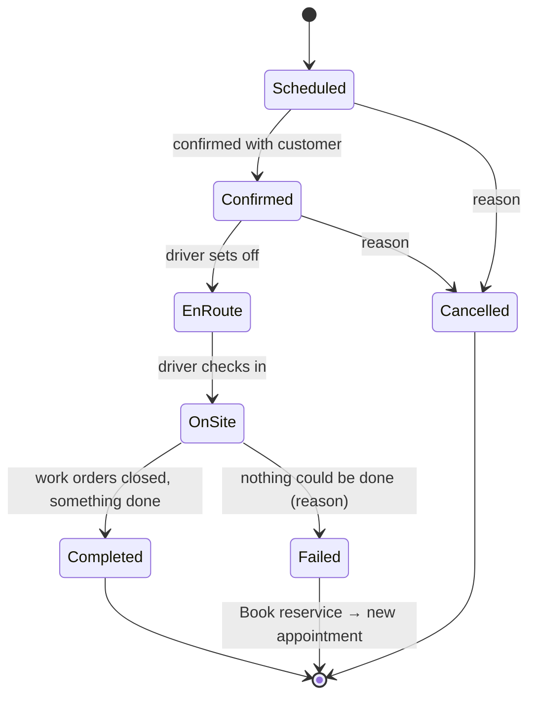

### 4.1 Work order outcome

When the driver records a work order, the outcome follows from what was counted:

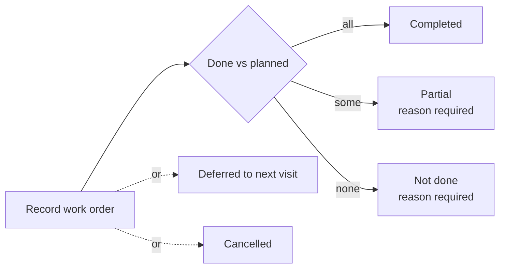

What the driver captures depends on how the item is handled:

| Handling | Example | Counted in | Weight from | Proof |
| --- | --- | --- | --- | --- |
| Empty on site | 1100L general bin | Lifts (tick each bin tag) | Estimate, later the route's weighbridge ticket | Fill level, contamination |
| Exchange | 10 CBM skip, 30 CBM RORO | Trips | Weighbridge ticket | Container taken / left, ticket no., facility |
| Packaged pickup | Medical bags, sharps boxes, drums | Bags / boxes / drums | On-site scale | Seal per unit, consignment note, empties left |
| Pump-out | Waste oil | Litres | Tanker meter | Manifest |
| Container logistics | Delivery, removal, check | Containers | - | Tag, photo |
| Secure destruction | Pharmaceuticals | kg | Scale | Seals, consignment note |

---

## 5. Example: a customer requests a service

**Friday 4 Sep, 11:00.** Karim Nassar, operations manager at **Marina Gate Mall – Food Court**, calls: the food court had a promotion, the 240L food bins are overflowing, and he wants an extra collection **tonight after closing (after 22:00)**.

What the site already has in the system:

- **Service line** `sp_07_l1`: `FOOD-240` 240L food-waste bins × 16, daily, window *after 22:00*. Customer service can already see its **projected visits** ("Scheduled by route RWC-DXB-REL-003 · tonight"), so Karim could have been told the next regular collection without this call.
- That line is attached to **Route** `RWC-DXB-REL-003` "Marina & Downtown REL Night" (night shift 19:00–24:00, REL compactor, general + food co-collected). That is the site's **default route**.
- Tonight's instance `RWC-DXB-REL-003-20260904-N` was generated last night: driver **Lena Fischer**, helpers **Joseph Mensah** and **Peter Otieno**, truck **DXB K 21907**, status *Planned*.

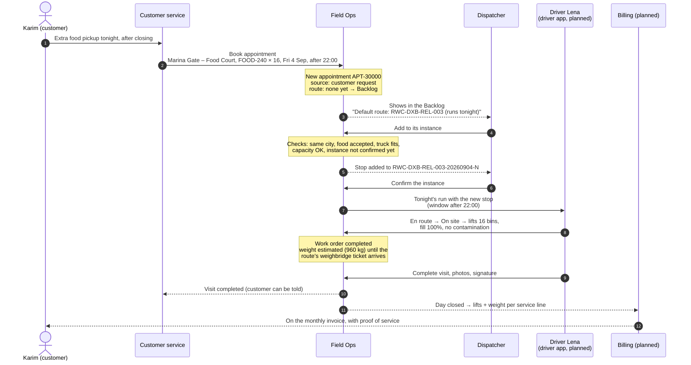

### 5.1 How the dispatcher decides where an ad-hoc job goes

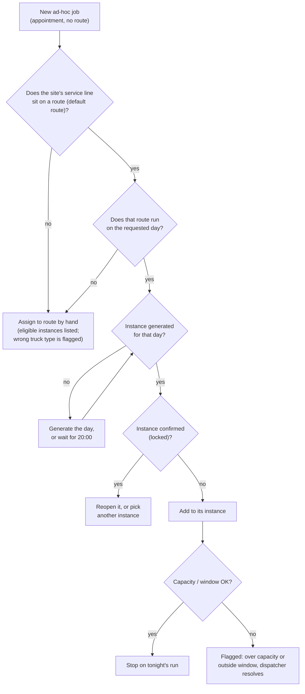

The same booking with different answers:

| Request | What happens |
| --- | --- |
| Food court, tonight (above) | Default route runs tonight → **Add to its instance** |
| Same site, Sunday (route runs daily) | Sunday isn't generated yet → it waits in the backlog until Sunday is generated, then one click |
| A Sharjah site on a Dubai-only day | No Sharjah route that day → **Assign to route** by hand, or book another day |
| Customer service checks the customer page | Each ad-hoc job shows **On <run>** (link to that day on Dispatch) or **Not on a run** with **Add to its run** when the default route's run that day can still take it |
| Skip delivery for a new site with no service line yet | No default route → **Assign to route** by hand; the skip loader route is offered first (matching truck) |
| Contract on credit hold | Booking is allowed, but recurring stops for that line are skipped at generation and flagged |

---

## 6. Where the driver mobile app fits (planned)

Today the dispatcher acts out the driver's steps on the appointment page. The app takes over the right-hand side of this picture; the flow and data stay the same.

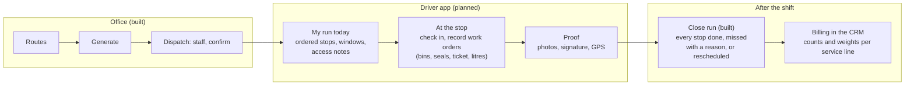

What the app will need from Field Ops (already in the data model): the instance with its ordered stops, each stop's site, address, GPS, access notes and time window, the work orders with their handling method (which drives what to capture), and the container tags at the site.

---

## 7. What is built and what is not

| Area | Status |
| --- | --- |
| Lookup lists, catalogue, fleet, service pros, shifts | Built (lookup lists read-only) |
| Routes: create, staff, attach, activate, version | Built |
| Dispatch engine: Generate, staffing, sequencing, flags | Built |
| Dispatch: staff slots, confirm, move stops, backlog | Built |
| Capacity (section 3.6): every truck limit, suggested fill rate, three-layer bar, snapshot at Confirm | Built; actuals roll-up to the Route and stream densities planned |
| Field Ops dashboard, customers (with projected visits), fleet, lookups (read-only) | Built |
| Reports page: utilisation, missed and moved by reason, substitution log, expiring certifications and permits | Built; route profitability planned (needs CRM prices and costs) |
| Sales: dashboard, leads, New agreement wizard | Built (mock CRM data) |
| Appointment execution and work order recording | Built, on the appointment page (dispatcher acts it out) |
| Driver mobile app | Planned |
| Instance moves to In progress / Completed by itself | Built: derived from its stops (the app will drive the stops) |
| Closing a run (R17, R18): resolve open stops, weighbridge tickets, odometer, actuals locked, adjustments | Built |
| Cancel a run or the whole day, with a reason; records kept, open stops back to the backlog | Built (holiday calendar and "skip holidays" planned) |
| Structured reschedule reasons (reason, who asked, from which day), shown in the appointments list | Built |
| Billing rules, monthly proof of service | Planned |
| CRM sync and API | Planned; customers, sites and contracts are mock data |

Everything changed in the prototype lives in the browser session and resets on reload.
