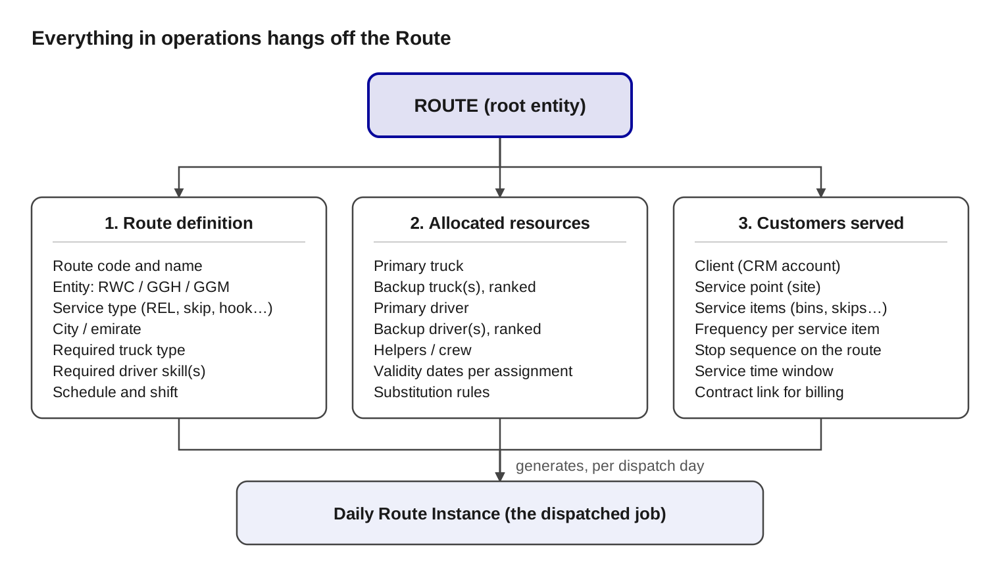
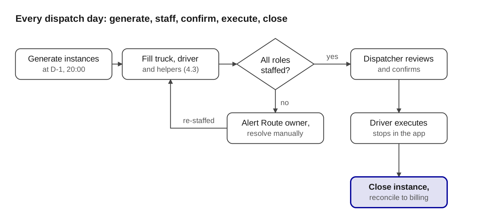

## Route Definition & Resource Allocation: Operations System Specification

Prepared by Mohamed Salah, Managing Director · 28 October 2026 · Renuterra Waste Collection Services L.L.C.

### 1. Purpose and scope

The Route is the root entity of the new Renuterra operations system that replaces Evreka. Every truck, driver, service point and service item exists in operations only because it is attached to a Route. If the Route model is wrong, dispatch, costing, billing reconciliation and reporting are all wrong. This document fixes the Route model so the development team can design the database, the admin screens and the daily dispatch engine from one agreed definition.

Scope of this document:

- The Route definition (the template) and its mandatory attributes.
- The assets allocated to a Route: trucks, drivers, helpers, with primary and backup rules.
- The commercial side of a Route: clients, service points and service items served.
- How a daily Route Instance is generated from the Route template and dispatched.
- Validation rules the system must enforce, and the master lists it depends on.

Out of scope here: mobile driver app UX, weighbridge and disposal-site integration, invoicing logic. These follow as separate specifications once the Route model is signed off.

Applies to all three entities: Renuterra Waste Collection (RWC), Golden Gate Hazardous (GGH) and Golden Gate Medical (GGM). One Route model, three operating companies.

### 2. Core concept: the Route is the root

A Route is a standing template, not a one-day job. It describes a repeatable collection run: what service it performs, where, with what kind of truck and driver, on which days and which shift. Resources and customers are then attached to that template. Each dispatch day the system generates a Route Instance from the template, and the instance is what the driver executes, what operations monitors, and what is reconciled against billing.

Read top down: the Route is defined first (layer 1), then resources are allocated to it (layer 2), then customers and service items are attached (layer 3). A Route cannot be activated until all three layers are complete. The daily instance inherits everything from the template and records what actually happened.

Two objects, two lifecycles:

| **Object**       | **What it is**                                      | **Lifecycle**                                         | **Owner**           |
|------------------|-----------------------------------------------------|-------------------------------------------------------|---------------------|
| Route (template) | Standing definition of a recurring run              | Created once, edited rarely, versioned                | Operations Manager  |
| Route Instance   | One execution of the template on one date and shift | Created by the dispatch engine daily, closed same day | Dispatcher / driver |

### 3. Route definition: mandatory attributes

A Route record carries the attributes below. Every one marked Required must be filled before the Route can move from Draft to Active. The five matching attributes (service type, city, truck type, driver skill, shift) are what the system later uses to validate that a truck or driver is eligible for the Route.

| **Attribute**            | **Type**     | **Required**                       | **Values / rule**                                                                                       | **Used for**                               |
|--------------------------|--------------|------------------------------------|---------------------------------------------------------------------------------------------------------|--------------------------------------------|
| Route code               | Text, unique | Yes                                | Format [Entity]-[City]-[ServiceType]-[NNN], e.g. RWC-DXB-REL-014                                        | Identification, reporting                  |
| Route name               | Text         | Yes                                | Human-readable, e.g. "Al Quoz REL Morning A"                                                            | Screens, driver app                        |
| Entity                   | Lookup       | Yes                                | RWC / GGH / GGM                                                                                         | Costing, billing company, licences         |
| Service type             | Lookup       | Yes                                | REL, Skip loader, Hook loader (RoRo), Medical waste, Hazardous waste, Bulk/compactor, Wastewater tanker | Truck and driver matching, pricing         |
| City / emirate           | Lookup       | Yes                                | Dubai, Abu Dhabi, Sharjah, Ajman, Fujairah, RAK, UAQ                                                    | Permits, disposal site, driver eligibility |
| Zone / area              | Lookup       | No                                 | Sub-area within the city (e.g. Al Quoz, JAFZA)                                                          | Planning, routing                          |
| Required truck type      | Lookup       | Yes                                | From the truck-type master (section 7); one primary type, optional alternates                           | Truck eligibility check                    |
| Required driver skills   | Multi-lookup | Yes                                | From the driver-skill master; all listed skills are mandatory                                           | Driver eligibility check                   |
| Schedule pattern         | Enum         | Yes                                | Daily, Weekdays (Mon–Sat), Weekly, Alternate days, Custom day set                                       | Instance generation                        |
| Schedule days            | Day set      | Yes if Weekly / Custom / Alternate | Days of week, or anchor date for alternate days                                                         | Instance generation                        |
| Shift                    | Enum         | Yes                                | Morning or Night, from the shift master; mandatory, one per Route                                       | Instance timing, driver hours              |
| Planned start / end time | Time         | Yes                                | Within the shift window                                                                                 | Driver app, lateness alerts                |
| Start depot              | Lookup       | Yes                                | Yard the truck leaves from                                                                              | Mileage, fuel                              |
| Disposal / transfer site | Lookup       | Yes                                | Site the route tips at; can be more than one                                                            | Weighbridge reconciliation                 |
| Planned capacity         | Number, unit | No                                 | Expected tonnes or m³ per run                                                                           | Productivity reporting                     |
| Status                   | Enum         | Yes                                | Draft, Active, Suspended, Retired                                                                       | Dispatch eligibility                       |
| Valid from / valid to    | Date         | Yes / No                           | A Route with no valid-to runs indefinitely                                                              | Instance generation                        |
| Owner                    | User         | Yes                                | Operations supervisor accountable for the Route                                                         | Escalation                                 |

Design notes for the team:

- Route code must be immutable once Active. Renaming is allowed; recoding is not, because instances, costs and reports hang off it.
- Changing any matching attribute on an Active Route creates a new Route version. Open instances keep the old version; the next generated instance uses the new one.
- A Route belongs to exactly one entity and one service type. A customer needing two service types at one site is served by two Routes.

#### 3.1 Waste streams accepted on the Route

At design time the Route declares which waste streams it collects. This is a multi-select attribute, separate from service type: service type says how we collect (REL, skip, hook), waste stream says what we collect. A Route may accept one stream or several, and only service items of an accepted stream can be attached to it.

| **Attribute**            | **Type**     | **Required**   | **Rule**                                                                                                                                         |
|--------------------------|--------------|----------------|--------------------------------------------------------------------------------------------------------------------------------------------------|
| Waste streams accepted   | Multi-lookup | Yes            | One or more codes from the waste-stream master (7.5)                                                                                             |
| Co-collection allowed    | Boolean      | Yes            | True when more than one stream is loaded in the same body on the same trip (e.g. general + food); false forces separate Routes or separate trips |
| Disposal site per stream | Lookup       | Yes per stream | Each accepted stream maps to its disposal, transfer or recycling site; a Route with two streams may tip at two sites                             |

Examples of valid Route designs:

- General waste only, REL, tips at landfill or transfer station.
- General + food waste co-collected, REL, single tip.
- Food waste only, REL or tanker, tips at the organics facility.
- Recyclables only (mixed dry recyclables, or a single stream such as cardboard or PET), REL or FEL, tips at the MRF.
- Hazardous streams never share a Route with non-hazardous streams; medical streams never share a Route with any other stream.

#### 3.2 Crew, shift and city: confirmed decisions

| **Attribute**     | **Decision**                                                                                                                                                                                                                                         | **Rule in the system**                                                                                      |
|-------------------|------------------------------------------------------------------------------------------------------------------------------------------------------------------------------------------------------------------------------------------------------|-------------------------------------------------------------------------------------------------------------|
| Required helpers  | Mandatory on every Route; the planner sets the count on the Route at design time. Service type only supplies the default (REL 2, Skip loader 1, Hook loader 1); two medical Routes can legitimately carry 1 and 2 helpers depending on their clients | Route cannot be activated without the helper count; instance is Unstaffed until every helper slot is filled |
| Shift window      | Mandatory; each Route belongs to exactly one shift from the shift master (e.g. Morning starting 05:00, Night 18:00–04:00)                                                                                                                            | Planned start and end must fall inside the shift window; a Route never straddles two shifts                 |
| City              | One city per Route, no exceptions: a Dubai Route serves Dubai only, Abu Dhabi only Abu Dhabi, Ajman, Fujairah and Umm Al Quwain likewise                                                                                                             | Service points in another city cannot be attached (R7); cross-emirate work is two Routes                    |
| Compression ratio | Fixed at 1:5 for REL compactors (25 m³ body = 125 m³ loose per trip)                                                                                                                                                                                 | Stored on the truck type, applied automatically in the capacity calculation                                 |

### 4. Resource allocation: trucks, drivers, crew

Resources are allocated to a Route through assignment records, never by editing the Route itself. Each assignment names the asset, its role (primary or backup), its rank among backups, and the dates it is valid. The Route stays stable while assignments change with leave, breakdowns and fleet moves.

#### 4.1 Assignment record

| **Field**       | **Type**   | **Rule**                                                                              |
|-----------------|------------|---------------------------------------------------------------------------------------|
| Route           | Lookup     | The Route being staffed                                                               |
| Asset type      | Enum       | Truck, Driver, Helper                                                                 |
| Asset           | Lookup     | Specific truck (plate) or employee (ID)                                               |
| Role            | Enum       | Primary, Backup                                                                       |
| Rank            | Number     | 1 = first backup, 2 = second; primaries always rank 0                                 |
| Days            | Day set    | Defaults to all Route days; can be narrowed (e.g. driver A Mon–Wed, driver B Thu–Sat) |
| Valid from / to | Date       | Assignment window; blank valid-to = open-ended                                        |
| Status          | Enum       | Active, Suspended                                                                     |

#### 4.2 Eligibility checks at assignment time

The system blocks an assignment that fails any of these checks and tells the user which one failed:

1. Truck type matches the Route's required truck type or one of its alternates.
2. Truck is registered to the Route's entity, or is in the shared pool.
3. Truck has valid registration, insurance and permits for the Route's city and service type (hazardous and medical need the relevant permits).
4. Driver holds every skill the Route requires (section 7), with certifications in date.
5. Driver licence class covers the truck type.
6. Driver is eligible to work in the Route's city (permit, induction).
7. Driver's shift pattern allows the Route's shift (no night Route on a morning-only driver).
8. No conflict: the same driver or truck is not primary on another Route with an overlapping day and shift.

#### 4.3 Substitution logic at dispatch time

When the dispatch engine generates a Route Instance it fills each role in this order:

1. Primary asset, if available on that date and shift.
2. Backups by rank, first one available.
3. Pool search: any eligible asset not already dispatched that day and shift, proposed to the dispatcher for confirmation.
4. No eligible asset → instance created with status Unstaffed and an alert raised to the Route owner.

"Available" means: status Active, not on leave or sick (driver), not in workshop or off-road (truck), not already allocated to another instance in the same shift, and within the assignment's valid dates.

#### 4.4 Rules the user asked for, made explicit

- A driver can be fixed to one Route every day: one primary assignment, days = all Route days.
- A driver can be shared across Routes by day: separate assignments with non-overlapping day sets.
- If the primary truck is unavailable, the engine dispatches the first available backup automatically; the dispatcher can override before the shift starts.
- A truck can be primary on a morning Route and backup on a night Route; the conflict check is per day and shift, not per day.
- Helpers are mandatory and follow the same assignment model; the required count is set on each Route at design time (service type gives the default: REL 2, skip loader 1, hook loader 1; a medical Route may need 1 or 2 depending on its clients) and an instance stays Unstaffed until every helper slot is filled.

### 5. Customers on the Route: service points and service items

The commercial layer links the Route to what gets billed. The chain is Client → Service Point → Service Item → Route Stop. Clients and service points are mastered in the CRM; the operations system references them by CRM ID and never creates its own copies. Service items carry the contract line that invoicing reconciles against.

| **Object**    | **Mastered in**   | **Key fields**                                                                                                                                                                                                    | **Relationship**                                          |
|---------------|-------------------|-------------------------------------------------------------------------------------------------------------------------------------------------------------------------------------------------------------------|-----------------------------------------------------------|
| Client        | CRM               | Customer ID, name, entity, account status, KAM                                                                                                                                                                    | One client has many service points                        |
| Service point | CRM               | Service point ID, client, address, GPS, access notes, contact, service window                                                                                                                                     | One service point has many service items                  |
| Service item  | CRM (contract)    | Item ID, service point, container type and size, quantity, waste stream, frequency, contract line, price basis (per lift / per tonne / per month), time window (e.g. before 06:00, or 06:00–08:00), default Route | Each active service item is attached to exactly one Route |
| Route stop    | Operations        | Route, service item, stop sequence, planned arrival, planned duration                                                                                                                                             | The Route's ordered list of what to do                    |

#### 5.1 Time windows live on the service item

The time window is set per entity, per service point and per service item, never only at client level. One location can hold several service items with different windows, served by different Routes and different trucks.

Example: a hospital in Al Garhoud has one service point with two service items. Item 1 is general waste, 1,100 L bins, collected by an RWC REL Route with a window of 05:00–08:00. Item 2 is medical waste, collected by a GGM medical Route with a window of 00:00–03:00. Same client, same site, two service items, two Routes, two time windows. The dispatcher sees and edits the window on the service item, and phase-1 sequencing places each stop inside its own window.

Window formats the system must support: before a time (before 06:00), after a time (after 22:00), a range (06:00–08:00), and no constraint.

Rules:

1. A service item can be attached to only one Active Route at a time. Moving it to another Route is a transfer with an effective date, not a duplicate.
2. A service item's frequency must be achievable by the Route's schedule. A twice-weekly item cannot sit on a weekly Route; a weekly item can sit on a daily Route with a day filter.
3. The service item's waste stream must be one of the Route's accepted waste streams (3.1), and compatible with the Route's service type. A food-waste bin cannot sit on a general-only Route; a medical sharps item cannot sit on a REL Route.
4. The service point's city must equal the Route's city.
5. Stop sequence is maintained per Route. Phase 1: the engine orders stops by each service item's time window first, then by proximity, and the dispatcher can reorder. Phase 2: full route optimisation from GPS tracks and actual cycle times.
6. A service item whose contract is expired, suspended or on credit hold is skipped at instance generation and flagged, not silently dropped.
7. Ad-hoc jobs (a client calls operations for a one-off service) are created as open, unassigned jobs. The dispatcher assigns each job to a Route instance; the job then becomes a stop on that instance with its own time window. A service point can carry a default Route, so a new ad-hoc job for that site is pre-assigned to it (e.g. an Al Quoz client's call lands on the Al Quoz daily Route) and the dispatcher only confirms or moves it. Ad-hoc jobs consume Route capacity like any other stop.

What the driver sees per stop: client name, site name, address and GPS, service items with quantities, container type, special instructions, and the proof required (photo, weight, signature).

### 6. Dispatch and daily execution

The dispatch engine runs every evening and creates one Route Instance for every Active Route that is due the next day under its schedule pattern and shift. The instance copies the Route's stops and fills the resource roles using the substitution order in 4.3. Nothing is executed from the template directly.

The loop on the left is the only manual step on a normal day: an unstaffed instance goes to the Route owner, who assigns an asset, and the instance returns to the staffed path.

#### 6.1 Route Instance record

| **Field**                          | **Source**                                          | **Notes**                                                                              |
|------------------------------------|-----------------------------------------------------|----------------------------------------------------------------------------------------|
| Instance ID                        | Generated                                           | [RouteCode]-[YYYYMMDD]-[Shift]                                                         |
| Route and Route version            | Template                                            | Frozen at generation                                                                   |
| Date, shift, planned start and end | Template                                            | Dispatcher may shift times before start                                                |
| Truck, driver, helpers             | Engine (4.3)                                        | Records primary vs substitute, and who overrode                                        |
| Stops                              | Template, filtered by frequency and contract status | Ordered; ad-hoc jobs can be inserted                                                   |
| Status                             | Engine and app                                      | Planned, Unstaffed, Confirmed, In progress, Completed, Partially completed, Cancelled  |
| Actuals per stop                   | Driver app                                          | Arrival and departure time, items serviced, weight, photo, signature, exception reason |
| Actuals per instance               | App and weighbridge                                 | Odometer out and in, tip weight per disposal site, fuel if captured                    |
| Closed by, closed at               | Dispatcher                                          | Closure locks actuals and releases them to billing and costing                         |

#### 6.2 Instance generation rules

1. Daily: one instance per calendar day in the Route's valid window.
2. Weekdays: Monday to Saturday; Friday excluded only if the Route's day set says so.
3. Weekly and custom day sets: on the listed days only.
4. Alternate days: every second day from the Route's anchor date, so two Routes can share a truck on opposite days.
5. Public holidays: generated unless the Route is flagged "skip holidays"; the dispatcher can cancel in bulk.
6. Generation horizon: D-1 by default; the dispatcher can pre-generate up to 7 days ahead for planning.
7. A stop is included only if its service item is due that day under its own frequency and its contract is active.
8. A cancelled instance keeps its record and reason; it is never deleted.

### 7. Master lists the Route depends on

All of these are admin-maintained lookup tables, not free text. Codes are what the matching rules compare; names are for screens. Initial values below are a starting set for operations to confirm; the team should build them as editable tables, not hard-coded enums.

#### 7.1 Service types

| **Code**   | **Name**                       | **Typical truck types**                | **Mandatory driver skills**                           |
|------------|--------------------------------|----------------------------------------|-------------------------------------------------------|
| REL        | Rear-end loader (wheelie bins) | REL 7–25m³                             | HGV, REL operation                                    |
| SKIP       | Skip loader                    | Skip loader 3–12 m³                    | HGV, Skip chain operation                             |
| HOOK       | Hook loader / RoRo             | Hook loader 20–40 m³                   | HGV, Hook / RoRo operation                            |
| COMP       | Compactor / bulk               | Compactor, flatbed                     | HGV                                                   |
| MED        | Medical waste                  | Refrigerated or enclosed box van/truck | LGV or HGV, Medical waste handling, Infection control |
| HAZ        | Hazardous waste                | ADR-rated box, tanker, flatbed         | HGV, ADR / hazardous handling, PPE and spill response |
| WWT        | Wastewater / sludge tanker     | Vacuum tanker                          | HGV, Tanker and vacuum operation                      |

#### 7.2 Truck types

| **Code**   | **Name**              | **Capacity (unit)**   | **Compatible service types**   |
|------------|-----------------------|-----------------------|--------------------------------|
| REL-07     | Rear loader 7 m³      | 7 m³                  | REL                            |
| REL-14     | Rear loader 14 m³     | 14 m³                 | REL                            |
| REL-25     | Rear loader 25 m³     | 25 m³                 | REL                            |
| SKP-STD    | Skip loader           | 1 skip, 3–12 m³       | SKIP                           |
| HOOK-STD   | Hook loader           | 1 RoRo, 20–40 m³      | HOOK                           |
| BOX-MED    | Enclosed box, medical | kg                    | MED                            |
| BOX-HAZ    | ADR box truck         | kg                    | HAZ                            |
| TNK-VAC    | Vacuum tanker         | m³                    | WWT, HAZ (liquid)              |
| FLT        | Flatbed               | tonnes                | COMP, HAZ (packaged)           |

Each truck in the fleet master carries: plate, entity, truck type, capacity, registration expiry, insurance expiry, permit list by city and service type, workshop status, telematics ID.

#### 7.3 Driver skill codes

| **Code**    | **Skill**                           | **Evidence held on file**   | **Expiry tracked**   |
|-------------|-------------------------------------|-----------------------------|----------------------|
| LIC-LGV     | Light goods licence                 | UAE licence class           | Yes                  |
| LIC-HGV     | Heavy goods licence                 | UAE licence class           | Yes                  |
| OP-REL      | REL operation                       | Internal induction          | No                   |
| OP-SKIP     | Skip chain operation                | Internal induction          | No                   |
| OP-HOOK     | Hook / RoRo operation               | Internal induction          | No                   |
| OP-FEL      | FEL operation                       | Internal induction          | No                   |
| OP-TANK     | Tanker and vacuum operation         | Internal induction          | No                   |
| HAZ-ADR     | Hazardous waste handling            | ADR / authority certificate | Yes                  |
| MED-IC      | Medical waste and infection control | Certificate                 | Yes                  |
| SAF-SPILL   | Spill response                      | Certificate                 | Yes                  |
| CITY-xxx    | Eligible to work in city xxx        | Permit / induction          | Yes where applicable |
| SHIFT-NIGHT | Cleared for night shift             | HR flag                     | No                   |

Each driver in the HR master carries: employee ID, entity, licence class, skills with expiry, home depot, default shift pattern, leave calendar.

#### 7.4 Cities, schedules, shifts

- Cities: DXB, AUH, SHJ, AJM, FUJ, RAK, UAQ, each with its permitted disposal sites.
- Schedule patterns: DAILY, WEEKDAYS, WEEKLY, ALT (alternate days with anchor date), CUSTOM (explicit day set).
- Shifts: MORNING (starts 05:00) and NIGHT (18:00–04:00), with exact windows held in the shift master per entity. Shift is mandatory on every Route.

#### 7.5 Waste streams

| **Code**   | **Stream**                  | **Typical service types**   | **Default destination**     | **Can co-collect with**   |
|------------|-----------------------------|-----------------------------|-----------------------------|---------------------------|
| GEN        | General (residual) waste    | REL, FEL, COMP, SKIP, HOOK  | Landfill / transfer station | FOOD                      |
| FOOD       | Food / organic waste        | REL, tanker                 | Organics / biogas facility  | GEN                       |
| MDR        | Mixed dry recyclables       | REL, FEL                    | MRF                         | None                      |
| CARD       | Cardboard / paper           | REL, FEL, HOOK              | MRF / baler                 | None                      |
| PET        | PET plastics                | REL, FEL                    | MRF / PET line              | None                      |
| GLASS      | Glass                       | SKIP, REL                   | Recycler                    | None                      |
| METAL      | Scrap metal                 | SKIP, HOOK                  | Recycler                    | None                      |
| CND        | Construction and demolition | SKIP, HOOK                  | C&D facility                | None                      |
| GREEN      | Garden / green waste        | SKIP, HOOK, REL             | Composting                  | None                      |
| WWS        | Wastewater / sludge         | WWT                         | Treatment plant             | None                      |
| MED        | Medical waste               | MED                         | GGM treatment facility      | None                      |
| HAZ-S      | Hazardous, solid / packaged | HAZ                         | GGH facility                | Other HAZ-S only          |
| HAZ-L      | Hazardous, liquid           | HAZ (tanker)                | GGH facility                | None                      |

Each stream carries its reporting category for diversion-rate reports and the carbon-credit tracking, so the stream code on the Route is what later classifies every tonne collected.

### 8. Route capacity

Every Route carries a capacity model, and the model depends on the service type. Compacting trucks are limited by compressed volume per trip; exchange trucks (skip, hook) are limited by the number of visits per shift; tankers, medical and hazardous Routes are limited by volume or weight. The system must calculate planned capacity from the truck type and the Route's timing, consume it as service items are attached, and report utilisation.

#### 8.1 Capacity basis by service type

| **Service type**            | **Capacity basis**         | **Per-trip limit**                                              | **Trips per shift**                                                 | **Route capacity per shift**                                  |
|-----------------------------|----------------------------|-----------------------------------------------------------------|---------------------------------------------------------------------|---------------------------------------------------------------|
| REL, FEL, COMP (compacting) | Loose volume collected     | Body volume × compression ratio (e.g. 25 m³ × 5 = 125 m³ loose) | Shift hours ÷ (collection time + travel to disposal + tip + return) | Per-trip limit × trips, then capped by legal payload (tonnes) |
| SKIP, HOOK (exchange)       | Number of visits (lifts)   | 1 container per visit                                           | Shift hours ÷ average cycle time (site → disposal → next site)      | Visits per shift; also capped by payload per lift             |
| WWT (tanker)                | Liquid volume              | Tank volume (m³)                                                | Shift hours ÷ (pump time + travel + discharge)                      | Tank volume × trips                                           |
| MED, HAZ                    | Weight and container count | Payload (kg) and secured container slots                        | Usually 1–2 trips                                                   | Payload × trips; container slots × trips                      |

#### 8.2 Compacting Routes: how volume is consumed

Each stop consumes loose volume = container size × quantity × fill rate. The standard fill rate is 80%. The dispatcher can override it on the service item record, which makes it effectively per client and per service point. Once history exists, the system calculates a suggested fill rate per service item from actual weights and lifts and shows it next to the manual value; the dispatcher accepts it or keeps the manual figure. The standard stays 80% until overridden.

| **Container**   | **Nominal volume**   | **Loose volume consumed at 80% fill**   |
|-----------------|----------------------|-----------------------------------------|
| 240 L bin       | 0.24 m³              | 0.19 m³                                 |
| 1,100 L bin     | 1.10 m³              | 0.88 m³                                 |
| 2.5 m³ skip-bin | 2.50 m³              | 2.00 m³                                 |
| 5 m³ skip-bin   | 5.00 m³              | 4.00 m³                                 |

Worked example, REL-25 truck: body 25 m³, compression ratio 5 → 125 m³ loose per trip. A Route of 1,100 L bins at 80% fill holds 125 ÷ 0.88 ≈ 142 bins per trip. If the shift allows 2 trips, Route capacity is about 284 bin lifts, subject to the truck's payload limit and the stop-time budget. The compression ratio is a truck-type attribute fixed at 1:5 for REL compactors, not a Route attribute, so a backup truck of a different body size recalculates capacity automatically.

#### 8.3 Exchange Routes: how visits are consumed

A skip or hook Route is a sequence of cycles: drive to the site, exchange or collect the container, drive to the disposal site, tip, drive to the next site. Capacity is the number of cycles that fit in the shift.

Worked example: 9-hour shift, 45 minutes of yard time, average cycle 75 minutes → 6 visits per shift. The Route planner sets the planned visit count from the zone's average cycle time; route optimisation (phase 2) will later refine it from actual GPS cycle times. Each service item attached to the Route consumes one visit per due date.

#### 8.4 Capacity attributes on the Route

Add these to the Route attribute table in section 3:

| **Attribute**           | **Type**     | **Rule**                                                                                                |
|-------------------------|--------------|---------------------------------------------------------------------------------------------------------|
| Capacity basis          | Enum         | Volume, Visits, Weight; defaulted from the service type                                                 |
| Per-trip capacity       | Number, unit | Calculated from the primary truck type; recalculated if the dispatched truck differs                    |
| Planned trips per shift | Number       | Set by the planner; default from shift length and disposal-site distance                                |
| Fill-rate assumption    | %            | Standard 80%; dispatcher can override per service item; system suggests a value from historical actuals |
| Planned stops / visits  | Number       | Derived: sum of attached service items due per day                                                      |
| Planned utilisation     | %            | Planned consumption ÷ Route capacity per shift; shown on the Route screen                               |
| Start point             | Lookup       | Depot or dispatch centre the trip starts from (already in section 3 as Start depot)                     |
| Disposal location(s)    | Lookup       | Where the Route tips; drives trip and cycle times                                                       |

#### 8.5 Capacity rules the system enforces

1. Attaching a service item that takes planned utilisation above 90% raises a warning; above 100% is blocked unless the Route owner overrides with a reason.
2. Capacity is checked per due day, not per Route total: a daily Route with weekly items is checked on the day those items fall.
3. When the dispatch engine substitutes a truck of smaller capacity, the instance is flagged Over capacity and the dispatcher must split stops to another instance or accept a second trip.
4. Actual utilisation (weighbridge tonnes, actual lifts, actual trips) is written back to the instance and rolled up to the Route so the planner can tune fill rate, cycle time and trip count from real data.
5. Capacity figures feed the Route costing view: cost per lift, cost per tonne and cost per trip, by entity.

### 9. Validation and business rules

The rules below are the acceptance criteria for the Route module. Each one must be enforced in the backend, not only in the UI, and each failure must return a readable message naming the rule.

| **#**   | **Rule**                                                                                                                                                      | **When checked**         | **Severity**                             |
|---------|---------------------------------------------------------------------------------------------------------------------------------------------------------------|--------------------------|------------------------------------------|
| R1      | Route code is unique across all entities and immutable once Active                                                                                            | Create, activate         | Block                                    |
| R2      | A Route cannot be activated without: entity, service type, city, truck type, driver skills, waste streams, schedule, shift, start depot, disposal site, owner | Activate                 | Block                                    |
| R3      | A Route cannot be activated without at least one primary truck and one primary driver assignment valid on its start date                                      | Activate                 | Block                                    |
| R4      | Assigned truck type must match the Route's required or alternate truck type                                                                                   | Assign                   | Block                                    |
| R5      | Assigned driver must hold every required skill, in date, and a licence class covering the truck                                                               | Assign, nightly re-check | Block; expiring within 30 days = warning |
| R6      | No asset may be primary on two Routes with the same day and shift                                                                                             | Assign                   | Block                                    |
| R7      | Service item city must equal Route city                                                                                                                       | Attach                   | Block                                    |
| R8      | Service item waste stream must be in the Route's accepted streams and compatible with the service type                                                        | Attach                   | Block                                    |
| R9      | Service item frequency must be achievable by the Route schedule                                                                                               | Attach                   | Block                                    |
| R10     | A service item is attached to at most one Active Route at a time; moving it is a dated transfer                                                               | Attach                   | Block                                    |
| R11     | Planned utilisation above 90% warns; above 100% blocks unless overridden with reason by the Route owner                                                       | Attach                   | Warn / Block                             |
| R12     | Hazardous and medical streams never share a Route with other streams; co-collection only where the stream master allows                                       | Design                   | Block                                    |
| R13     | Changing a matching attribute (service type, city, truck type, skills, streams, shift) on an Active Route creates a new version; open instances are untouched | Edit                     | Enforced automatically                   |
| R14     | Instances are generated only for Active Routes inside their valid dates                                                                                       | Generation               | Enforced automatically                   |
| R15     | Expired, suspended or credit-hold contracts are skipped at generation and listed in the daily exception report                                                | Generation               | Flag                                     |
| R16     | A substituted truck of lower capacity flags the instance Over capacity; the dispatcher must resolve before confirming                                         | Generation               | Warn                                     |
| R17     | An instance cannot be closed with stops in status Pending; each must be Completed, Missed with reason, or Rescheduled                                         | Closure                  | Block                                    |
| R18     | Closed instances are read-only; corrections go through a dated adjustment record                                                                              | Post-closure             | Block                                    |
| R19     | Every Route, assignment, attachment and override is audit-logged with user and timestamp                                                                      | Always                   | Enforced automatically                   |
| R20     | Deletion is never physical: Routes are Retired, assignments Suspended, instances Cancelled                                                                    | Always                   | Enforced automatically                   |

Rules confirmed with operations on 28 October 2026:

| **#**   | **Rule**                                                                                                                                                                          | **When checked**       | **Severity**   |
|---------|-----------------------------------------------------------------------------------------------------------------------------------------------------------------------------------|------------------------|----------------|
| R21     | Helper count is mandatory and set per Route at design time (service type supplies the default: REL 2, Skip 1, Hook 1); an instance is Unstaffed until all helper slots are filled | Activate, generation   | Block          |
| R22     | Every Route has exactly one shift; planned times must sit inside the shift window                                                                                                 | Activate               | Block          |
| R23     | A Route serves one city only; no multi-city Routes                                                                                                                                | Activate, attach       | Block          |
| R24     | An ad-hoc job must be assigned to a Route instance before it can be executed; the service point's default Route is proposed automatically                                         | Job creation, dispatch | Block          |
| R25     | Phase-1 sequencing must honour every stop's time window; a stop that cannot be placed inside its window is flagged to the dispatcher, not silently placed                         | Generation             | Warn           |

### 10. Worked examples

Three Routes that between them exercise every rule above. Values are illustrative for the development team, not live operational data.

| **Attribute**                    | **Example A**                                                         | **Example B**                                        | **Example C**                                |
|----------------------------------|-----------------------------------------------------------------------|------------------------------------------------------|----------------------------------------------|
| Route code                       | RWC-DXB-REL-014                                                       | RWC-DXB-SKIP-007                                     | GGM-DXB-MED-002                              |
| Route name                       | Al Quoz REL Morning A                                                 | Al Quoz Skip Alternate                               | Healthcare Jumeirah Weekly                   |
| Entity                           | RWC                                                                   | RWC                                                  | GGM                                          |
| Service type                     | REL                                                                   | SKIP                                                 | MED                                          |
| Waste streams                    | GEN + FOOD, co-collection on                                          | CND, GEN (separate trips)                            | MED only                                     |
| City / zone                      | Dubai / Al Quoz                                                       | Dubai / Al Quoz                                      | Dubai / Jumeirah                             |
| Required truck type              | REL-22 (alternate REL-14)                                             | SKP-STD                                              | BOX-MED                                      |
| Required driver skills           | LIC-HGV, OP-REL, CITY-DXB                                             | LIC-HGV, OP-SKIP, CITY-DXB                           | LIC-LGV, MED-IC, CITY-DXB                    |
| Schedule                         | Daily, Mon–Sat                                                        | Alternate days, anchor 2026-11-01                    | Weekly, Tuesday                              |
| Shift and times                  | Morning, 05:00–13:00                                                  | Morning, 06:00–15:00                                 | Morning, 07:00–12:00                         |
| Start depot                      | Al Quoz yard                                                          | Al Quoz yard                                         | GGM Dubai depot                              |
| Disposal site(s)                 | Transfer station (GEN), organics facility (FOOD)                      | C&D facility; landfill for GEN trips                 | GGM Fujairah treatment facility via transfer |
| Capacity basis                   | Volume                                                                | Visits                                               | Weight + containers                          |
| Per-trip capacity                | 22 m³ × 5 = 110 m³ loose                                              | 1 skip per visit                                     | 1,200 kg, 40 container slots                 |
| Planned trips / visits per shift | 2 trips                                                               | 6 visits (cycle 75 min)                              | 1 trip                                       |
| Fill-rate assumption             | 80%                                                                   | n/a                                                  | n/a                                          |
| Primary truck                    | DXB-REL-11                                                            | DXB-SKP-04                                           | DXB-MED-02                                   |
| Backup trucks                    | DXB-REL-12 (rank 1), DXB-REL-09 (rank 2, REL-14)                      | DXB-SKP-05                                           | DXB-MED-03                                   |
| Primary driver                   | Driver 1041, all days                                                 | Driver 1088, all days                                | Driver 2012, Tuesday                         |
| Backup drivers                   | Driver 1057 (rank 1)                                                  | Driver 1091                                          | Driver 2015                                  |
| Helpers                          | 2                                                                     | 0                                                    | 1                                            |
| Attached service items           | 118 × 1,100 L GEN bins, 36 × 240 L FOOD bins across 41 service points | 5 × 6 m³ CND skips, 1 × 8 m³ GEN skip across 6 sites | 22 clinics, sharps and yellow-bag containers |
| Planned utilisation              | (118 × 0.88 + 36 × 0.19) ÷ 220 = 50%                                  | 6 ÷ 6 = 100%                                         | Weight-based, about 70%                      |

What each example proves:

- Example A: two streams co-collected in one body with a single tip per stream, a REL-14 backup that recalculates capacity to 70 m³ per trip and triggers the Over capacity flag only if utilisation passes 100% on that truck, and a daily schedule carrying weekly items by day filter.
- Example B: an alternate-day schedule that lets the same truck and driver serve a sister Route on the opposite days, capacity counted in visits, and two streams that may not share a trip, so the engine builds separate trips inside one instance.
- Example C: a weekly Route under a different entity, skill and permit checks that are certificate-based with expiry, and weight capacity with container slots.

Suggested acceptance test: create all three Routes, activate them, attach the items listed, then run generation for 1–14 November 2026 and confirm the instance count is 12 for A, 7 for B and 2 for C.

### 11. Integration points and outputs

The Route module reads masters from the CRM and HR/fleet, and writes closed actuals to billing and finance. It is never the master for customers or contracts.

| **Direction**   | **System**                       | **Data**                                                                              | **Trigger**                                         |
|-----------------|----------------------------------|---------------------------------------------------------------------------------------|-----------------------------------------------------|
| In              | Renuterra CRM                    | Clients, service points, service items, contract status, credit hold                  | Near real time; nightly full sync before generation |
| In              | HR master                        | Drivers, skills and expiries, leave calendar, shift pattern                           | Daily                                               |
| In              | Fleet master / telematics        | Trucks, type, permits, workshop status, GPS, odometer                                 | Near real time                                      |
| In              | Weighbridge / disposal sites     | Tip weight per instance and stream                                                    | On ticket                                           |
| Out             | Billing (CRM → Business Central) | Closed instance actuals per service item: lifts, weights, exceptions, proof           | On instance closure                                 |
| Out             | Business Central                 | Route costing: fuel, driver hours, tip fees, by entity and Route                      | Daily batch                                         |
| Out             | CRM customer reporting           | Collected tonnes by stream and service point for diversion-rate and recycling reports | Monthly                                             |
| Out             | Sustainability / carbon tracking | Tonnes by stream and destination                                                      | Monthly                                             |

Standard reports the module must produce from day one:

1. Daily dispatch board: every instance, status, truck, driver, stops done vs planned, exceptions.
2. Route utilisation: planned vs actual capacity per Route, trend by week.
3. Missed and rescheduled stops by reason, by Route and by customer.
4. Substitution log: how often backups and pool assets were used, by Route.
5. Expiring certifications and permits affecting Routes in the next 30 days.
6. Route profitability: revenue from attached contracts vs Route cost, by entity.

CRM identifiers are the foreign keys everywhere; the operations system stores them, never re-keys them.

### 12. Decisions, open items and next steps

Decisions taken on 28 October 2026 (closed; build to these):

| **Topic**          | **Decision**                                                                                                                                           |
|--------------------|--------------------------------------------------------------------------------------------------------------------------------------------------------|
| Truck-type list    | Section 7.2 approved as the starting set                                                                                                               |
| Compression ratio  | 1:5 for REL compactors; 25 m³ body = 125 m³ loose per trip                                                                                             |
| City scope         | One city per Route; Dubai, Abu Dhabi, Ajman, Fujairah, Umm Al Quwain each strictly separate                                                            |
| Helpers            | Mandatory; count set per Route at design time (defaults REL 2, Skip 1, Hook 1; medical, tanker and other Routes set individually, e.g. 1 or 2 helpers) |
| Shift              | Mandatory; one shift per Route from the shift master (Morning from 05:00, Night 18:00–04:00)                                                           |
| Ad-hoc jobs        | Open unassigned job → dispatcher assigns to a Route instance; service point can carry a default Route for automatic pre-assignment                     |
| Route optimisation | Phase 1: sequencing by service-item time windows then proximity. Phase 2: full optimisation from GPS and actual cycle times                            |
| CRM API            | Handled in the integration workstream (section 11)                                                                                                     |

Added the same day:

- Fill rate: standard 80%; dispatcher can override per service item; system suggests a value from historical actuals (8.2).
- Time windows: per entity, per service point, per service item, so one site can have different windows for different items and Routes (5.1).
- Helpers: count is a Route-level design attribute; service type only provides the default (3.2).

Next steps:

1. Development team returns a data model (ERD) and API contract for Route, Assignment, Route Stop and Route Instance based on this document.
2. Operations provides the full current Route list from the existing system, mapped to the new attributes, as the migration dataset.
3. The three worked examples in section 10 become the first automated tests.
4. Review meeting to sign off the model before screen design starts.